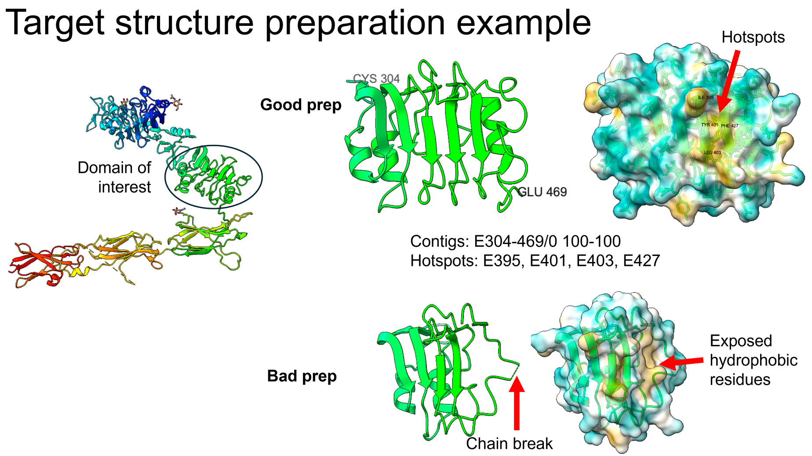
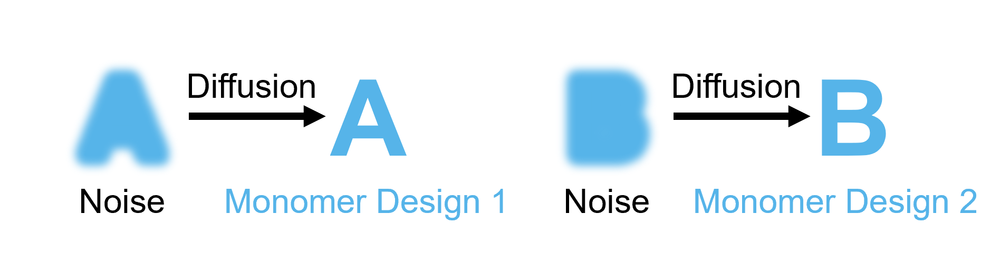
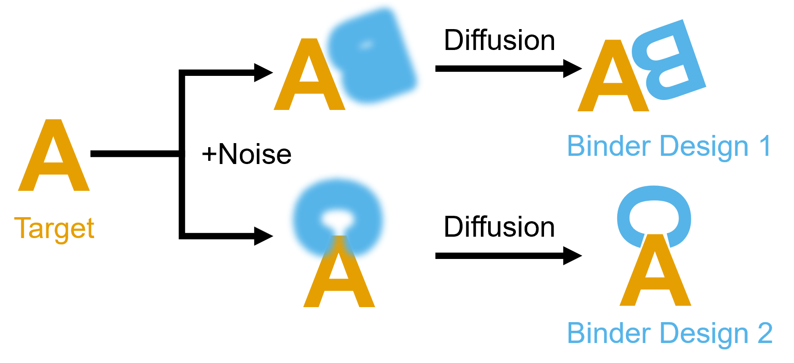
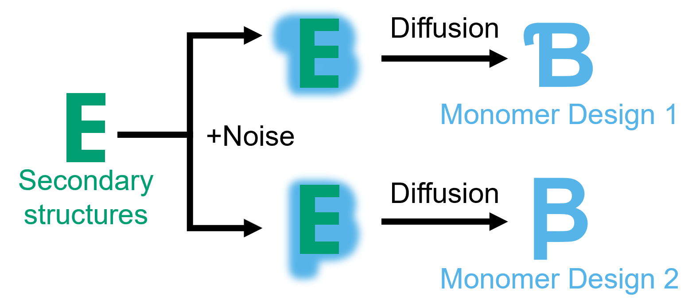
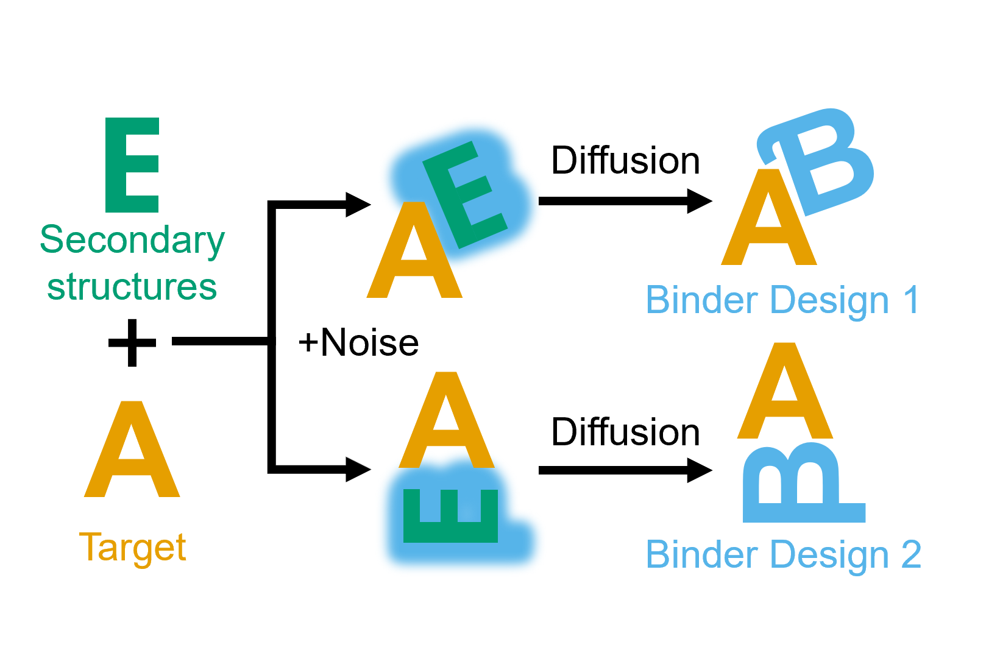
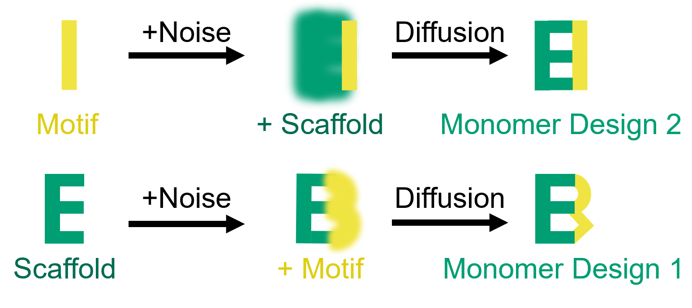
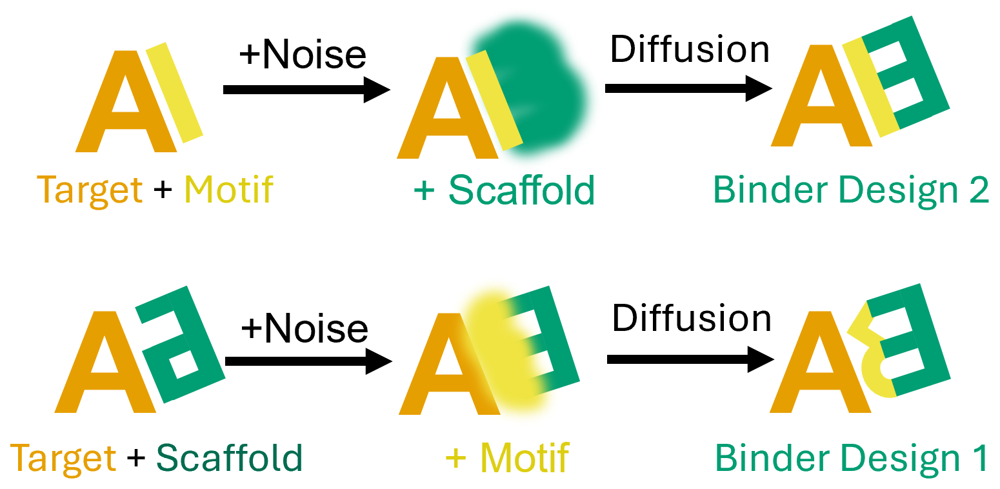
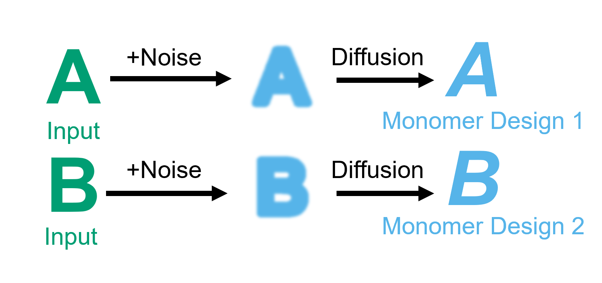
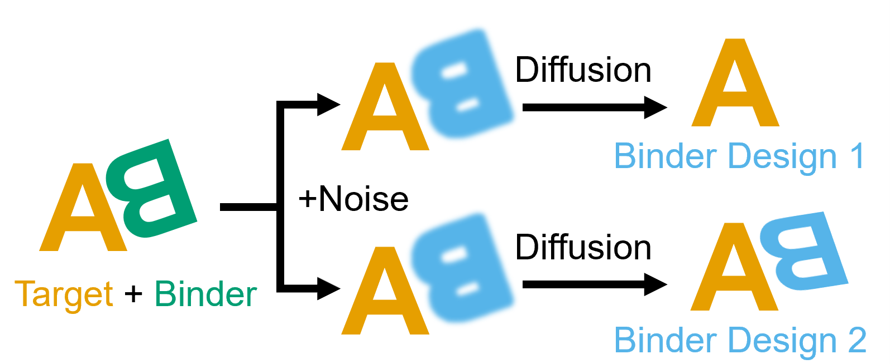
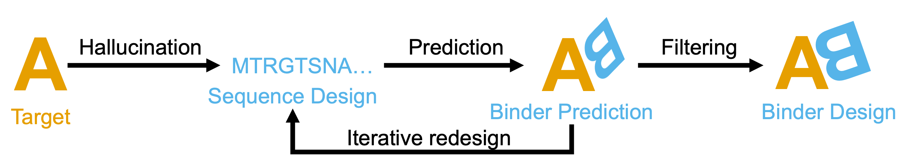

[🏠 ProteinDJ](../README.md) > Design Modes Guide

# ProteinDJ Guide to Design Modes

Due to the creative nature of protein design and the complexity of RFdiffusion there are many ways you can use ProteinDJ. To help with delineating this, we have created design modes for ProteinDJ. Each mode is described in detail below, but for now, here's a quick summary of each one with a simple illustration of each mode in action:

[**RFdiffusion design**](#rfddesign) - each mode below automatically runs as either monomer or binder design, depending on whether a target `input_pdb` is provided
- [**rfd_denovo**](#mode-rfddenovo) – diffusion of new monomers/binders from noise
- [**rfd_foldcond**](#mode-rfdfoldcond) – diffusion of new monomers/binders with fold-conditioning on scaffolds/templates
- [**rfd_motifscaff**](#mode-rfdmotifscaff) – inpainting/extension of input monomers, or diffusion of binding motifs in input scaffolds / scaffolds around binding motifs
- [**rfd_partialdiff**](#mode-rfdpartdiff) – partial diffusion of an input monomer or binder

[**BindCraft design**](#bindcraftdesign)
- [**bindcraft_denovo**](#mode-bindcraft) - hallucination of a binder using BindCraft

[**BoltzGen design**](#boltzgendesign) - each mode below automatically runs as either monomer or binder design, depending on whether a target `input_pdb` is provided
- [**boltzgen_denovo**](#mode-boltzgendenovo) – generative design of new monomers/binders using BoltzGen
- [**boltzgen_motifscaff**](#mode-boltzgenmotifscaff) – redesign/rediffusion of an existing monomer/binder using BoltzGen

[**RFD4-Proteina design**](#rfd4design)
- [**rfd4_denovo**](#mode-rfd4denovo) – co-design a binder's sequence and structure against a single-chain target, then refold it for evaluation

## Preparing Target Structures for Binder Design <a name="binderdesign"></a>

To design binders with ProteinDJ, it is important to prepare your target structure. Ideally, your structure will be a high-resolution experimental structure or a high-confidence structural prediction. Ligands are not compatible with ProteinDJ. Non-natural amino acids in protein chains will result in an error from RFdiffusion and be replaced by alanines in BindCraft, so it is best to replace these with a suitable natural amino acid before running ProteinDJ. Since the runtime of these programs scale exponentially with target size you might want to crop the size of your target to a minimal domain. See below for an example of how to prepare a structure. You should avoid exposing hydrophobic cores of your target domain as RFdiffusion/BindCraft/BoltzGen will likely want to design a binder there (since they have a bias towards hydrophobic patches).



If you want to test your binder designs in the context of a larger structure or complex, you can provide a separate PDB file to AlphaFold2 Initial-Guess/Boltz-2 using the `uncropped_target_pdb` parameter. This is more computationally efficient - about 6x faster than using the same larger structure as an input model for RFdiffusion/BindCraft/BoltzGen. Note that if the binder has been designed to an interface that is no longer available in the full context, this will be reflected by poor AlphaFold2/Boltz2 metrics, especially af2_rmsd_binder_tgtaln/boltz_rmsd_overall and af2_pae_interaction/boltz_iptm.

### Specifying Hotspot / Target Residues <a name="specifying-hotspot--target-residues"></a>

`hotspot_residues` (RFdiffusion, BindCraft, BoltzGen) and BoltzGen's `bg_not_binding_residues` both share the same residue-spec grammar: a comma-separated list of tokens, where each token is a chain-qualified single residue (e.g. `A56`), a chain-qualified range (e.g. `A115-120`), or a bare chain ID meaning every residue in that chain (e.g. `B`). A chain identifier is always required, e.g. `hotspot_residues = 'A56,A115-120,B'`.

## RFdiffusion Design <a name="rfddesign"></a>

Each of the four RFdiffusion modes (`rfd_denovo`, `rfd_foldcond`, `rfd_motifscaff`, `rfd_partialdiff`) automatically runs as **monomer design** or **binder design** depending on whether a target `input_pdb` is provided (and, where relevant, whether the input PDB describes a single chain or multiple chains). You do not need to select monomer vs. binder explicitly - ProteinDJ detects this automatically at runtime. Contigs (RFdiffusion's internal residue-range specification) are now also generated automatically for you from your `input_pdb` and/or `design_length` - you never need to write them by hand. Your input PDB should only include the target residues you actually want RFdiffusion to build against; if you have missing loops or residues in your target, remove/exclude them from the PDB first (e.g. in ChimeraX/PyMOL), the same way you would prepare an input PDB for BindCraft or BoltzGen.

### RFdiffusion De Novo Mode (rfd_denovo) <a name="mode-rfddenovo"></a>

The simplest use of RFdiffusion is to generate a monomeric protein from noise, or a binder against a target protein.

**Monomer design**



To generate a de novo monomer is straightforward. All we need to provide is a design length specifying the residue length range of the design, and no `input_pdb`. For example, to generate de novo proteins of length 80 residues, we provide the design_length `'80'`:

```
rfd_denovo_monomer {
    params {
        design_mode = 'rfd_denovo'
        design_length = '80'
    }
}
```

If we wanted to vary the length, we can specify a range e.g. `'80-150'` and RFdiffusion will randomly sample a length between 80 and 150 residues for each design:

```
rfd_denovo_monomer {
    params {
        design_mode = 'rfd_denovo'
        design_length = '80-150'
    }
}
```

For more details on De Novo protein design, see the [RFdiffusion GitHub](https://github.com/RosettaCommons/RFdiffusion/tree/main?tab=readme-ov-file#basic-execution---an-unconditional-monomer)

**Binder design**



Binder de novo mode can be used to diffuse highly diverse binders to a target protein. Simply providing an `input_pdb` alongside `design_mode = 'rfd_denovo'` switches ProteinDJ into binder design automatically.

In this example, we are designing de novo binders against a target protein (PD-L1). We first need to decide on our target protein boundaries. It is important to keep the target protein minimal for computational efficiency without exposing hydrophobic patches. In this case we will include all residues from our input PDB so we can take advantage of automatic contig generation and only need to provide a design length e.g. `design_length = '60-100'` to diffuse binders of variable length between 60-100 residues. We are not specifying hotspot residues, so RFdiffusion will automatically identify binding sites for design.

```
rfd_denovo_binder {
    params {
        design_mode = 'rfd_denovo'
        design_length = '60-100'
        input_pdb = "./benchmarkdata/5o45_pd-l1.pdb"
    }
}
```

We can also specify hotspot residues to guide binder positioning (`hotspot_residues = "A56,A115,A123"`; ranges e.g. `A115-120` and whole chains e.g. `B` are also accepted):

```
rfd_denovo_binder {
    params {
        design_mode = 'rfd_denovo'
        design_length = '60-100'
        input_pdb = "./benchmarkdata/5o45_pd-l1.pdb"
        hotspot_residues = "A56,A115,A123"
    }
}
```

We can also lower the noise scale used during diffusion (`rfd_noise_scale = 0`) and the temperature used for sampling sequences (`mpnn_temperature = 0.0001`) to reduce diversity and creativity but increase success rates (see configuration example below)

```
rfd_denovo_binder {
    params {
        design_mode = 'rfd_denovo'
        input_pdb = "./benchmarkdata/5o45_pd-l1.pdb"
        hotspot_residues = "A56,A115,A123"
        rfd_noise_scale = 0
        mpnn_temperature = 0.0001
    }
}
```

Since RFdiffusion tends to produce alpha-helical rich binders, we can override the model checkpoint used for diffusion (defaults to `complex_base`) to increase the number of beta-strand rich binders (`rfd_ckpt_override = 'complex_beta'`). You might also want to try the 'rfd_foldcond' mode with beta-strand binder scaffolds.

```
rfd_denovo_binder {
    params {
        design_mode = 'rfd_denovo'
        design_length = '60-100'
        input_pdb = "./benchmarkdata/5o45_pd-l1.pdb"
        hotspot_residues = "A56,A115,A123"
        rfd_ckpt_override = 'complex_beta'
        rfd_noise_scale = 0
        mpnn_temperature = 0.0001
    }
}
```

**Advanced: flexible target regions**

If part of your target has a disordered/flexible region (e.g. a loop) whose structure you don't want RFdiffusion to condition on, mark it with `flexible_residues` (target chain(s) only, since the binder chain is entirely new in this mode). RFdiffusion will simultaneously design the binder and predict the structure of that region within the complex:

```
rfd_denovo_binder {
    params {
        design_mode = 'rfd_denovo'
        design_length = '60-100'
        input_pdb = "./benchmarkdata/5o45_pd-l1.pdb"
        flexible_residues = "A10-35"
    }
}
```

For more information on de novo binder design, see the official [RFdiffusion GitHub](https://github.com/RosettaCommons/RFdiffusion/tree/main?tab=readme-ov-file#binder-design)

### RFdiffusion Fold Conditioning Mode (rfd_foldcond) <a name="mode-rfdfoldcond"></a>

Fold conditioning guides the RFdiffusion diffusion process by providing secondary structure information from scaffolds e.g. barrels, helical bundles etc.

**Monomer design**



To run fold conditioning you need a directory containing pytorch files (`rfd_foldcond_scaffold_dir`) with secondary structure and block adjacency information for each scaffold e.g. scaffold1_ss.pt scaffold2_adj.pt. You can generate these from a pdb or directory of pdbs (see [Scaffold Generation Guide](../docs/scaffolds.md)). RFdiffusion will select a random scaffold from the directory for each design during the backbone diffusion process. Here we will use a directory of assorted scaffolds in `proteindj/binderscaffolds/scaffolds_assorted`. No `input_pdb` is provided, so this runs as monomer design.

```
rfd_foldcond_monomer {
    params {
        design_mode = 'rfd_foldcond'
        rfd_foldcond_scaffold_dir = "./binderscaffolds/scaffolds_assorted"
    }
}
```

If you want to add more variation to the scaffolds, you can pass additional parameters to RFdiffusion (using the `rfd_extra_config` parameter). For example, to add up to 15 residues into any loop between secondary structure elements, and up to 5 additional residues at the N- and C-terminus:

```
rfd_foldcond_monomer {
    params {
        design_mode = 'rfd_foldcond'
        rfd_foldcond_scaffold_dir = "./binderscaffolds/scaffolds_assorted"
        rfd_extra_config = "scaffoldguided.sampled_insertion=15 scaffoldguided.sampled_N=5 scaffoldguided.sampled_C=5"
    }
}
```

For more details on Fold Conditioning, see the official [RFdiffusion GitHub](https://github.com/RosettaCommons/RFdiffusion?tab=readme-ov-file#fold-conditioning)

**Binder design**



One approach to improving the success rate of binder design is to use scaffolds to guide RFdiffusion e.g. 3-alpha helical bundles. Providing an `input_pdb` switches this mode into binder design.

To enable scaffold guided binder design you need a directory containing pytorch files (`rfd_foldcond_scaffold_dir`) with secondary structure and block adjacency information for each scaffold e.g. scaffold1_ss.pt scaffold2_adj.pt. You can generate these from an input pdb or set of pdbs (see [Scaffold Generation Guide](../docs/scaffolds.md)). RFdiffusion will select a random scaffold from the directory for each design during the backbone diffusion process. We have generated pytorch files for the recommended scaffolds from [Cao et al. 2021](https://doi.org/10.1038/s41586-022-04654-9) (~23,000 templates) in `scripts/recmndscaffs.tar.gz` - see more details about the composition of these scaffolds and how to make your own [here](../docs/scaffolds.md).

RFdiffusion also requires these .pt files for the target PDB file. We generate these target .pt files internally for you using BioPython/PyTorch. We have noticed that ligands, insertion codes (e.g. res 82A, 82B), and non-standard amino acid codes (e.g. TPO, SEP) cause errors, so it is best to remove them from input structures first

Note that when using scaffolds contigs are ignored i.e. the binder length is determined by each template/scaffold and the entire input PDB is passed to RFdiffusion. You may need to edit your input PDB to remove unwanted residues/domains from the target protein first.

The RFdiffusion GitHub also recommends setting `rfd_foldcond_mask_loops = false` when using scaffolds for binder design. This will preserve the loops from the input scaffolds. If 'true', then RFdiffusion may vary the loops which will provide more diversity but lower success rates.

```
rfd_foldcond_binder {
    params {
        design_mode = 'rfd_foldcond'
        input_pdb = "./benchmarkdata/5o45_pd-l1.pdb"
        hotspot_residues = "A56,A115,A123"
        rfd_foldcond_scaffold_dir = "./binderscaffolds/scaffolds_assorted"
        rfd_foldcond_mask_loops = false
    }
}
```

We can also lower the noise used during diffusion (`rfd_noise_scale = 0`) and the temperature used for sampling sequences (`mpnn_temperature = 0.0001`) to reduce diversity and creativity but increase success rates e.g.

```
rfd_foldcond_binder {
    params {
        design_mode = 'rfd_foldcond'
        input_pdb = "./benchmarkdata/5o45_pd-l1.pdb"
        hotspot_residues = "A56,A115,A123"
        rfd_foldcond_scaffold_dir = "./binderscaffolds/scaffolds_assorted"
        rfd_foldcond_mask_loops = false
        rfd_noise_scale = 0
        mpnn_temperature = 0.0001
    }
}
```

As with `rfd_denovo` binder design, you can mark a disordered/flexible target region with `flexible_residues` (target chain(s) only) so RFdiffusion doesn't condition on that region's structure:

```
rfd_foldcond_binder {
    params {
        design_mode = 'rfd_foldcond'
        input_pdb = "./benchmarkdata/5o45_pd-l1.pdb"
        hotspot_residues = "A56,A115,A123"
        rfd_foldcond_scaffold_dir = "./binderscaffolds/scaffolds_assorted"
        rfd_foldcond_mask_loops = false
        flexible_residues = "A10-35"
    }
}
```

For more details on Fold Conditioning, see the official [RFdiffusion GitHub](https://github.com/RosettaCommons/RFdiffusion?tab=readme-ov-file#fold-conditioning)

### RFdiffusion Motif Scaffolding Mode (rfd_motifscaff) <a name="mode-rfdmotifscaff"></a>

Motif scaffolding, also known as inpainting, uses a reference scaffold and adds one or more motifs to generate a new structure. `input_pdb` is always required for this mode, plus one of `motifscaff_spec`/`motifscaff_inpaint_seq`/`flexible_residues`; whether it runs as monomer or binder design is auto-detected from the number of chains in your `input_pdb`.

**Monomer design**



`motifscaff_spec` describes chain A's new architecture as an ordered, comma-separated list of chain-A 'keep' tokens (e.g. `A10-50` or `A60`) and bare-digit 'insert' tokens (e.g. `10` for an exact count or `7-10` for a sampled range). For example, to add 5-15 residues to the N-terminus and 30-40 residues to the C-terminus of PD-L1 (keeping residues A17-131):

```
rfd_motifscaff_monomer {
    params {
        design_mode = 'rfd_motifscaff'
        input_pdb = "./benchmarkdata/5o45_pd-l1.pdb"
        motifscaff_spec = '5-15,A17-131,30-40'
    }
}
```

We could also replace the first 10 amino acids of chain A with 5-15 new residues:

```
rfd_motifscaff_monomer {
    params {
        design_mode = 'rfd_motifscaff'
        input_pdb = "./benchmarkdata/5o45_pd-l1.pdb"
        motifscaff_spec = '5-15,A27-131'
    }
}
```

Or we could even do multiple insertions/replacements within chain A of variable lengths:

```
rfd_motifscaff_monomer {
    params {
        design_mode = 'rfd_motifscaff'
        input_pdb = "./benchmarkdata/5o45_pd-l1.pdb"
        motifscaff_spec = 'A17-43,9-15,A53-117,3-6,A121-131'
    }
}
```

Finally, we can mask the sequence of the first three and last three kept residues to allow RFdiffusion to design new residues without changing the backbone using `motifscaff_inpaint_seq`:

```
rfd_motifscaff_monomer {
    params {
        design_mode = 'rfd_motifscaff'
        input_pdb = "./benchmarkdata/5o45_pd-l1.pdb"
        motifscaff_spec = 'A17-43,9-15,A53-117,3-6,A121-131'
        motifscaff_inpaint_seq = 'A17-19,A129-131'
    }
}
```

For more details on Motif Scaffolding, see the official [RFdiffusion GitHub](<[https://github.com/RosettaCommons/RFdiffusion/tree/main?tab=readme-ov-file#partial-diffusion](https://github.com/RosettaCommons/RFdiffusion/tree/main?tab=readme-ov-file#motif-scaffolding)>)

**Binder design**



We can also use motif scaffolding to add binding motifs to an input structure that already contains both a binder and a target chain, which ProteinDJ auto-detects as binder design. `motifscaff_spec` only ever describes chain A (the binder) - any target chain(s) in `input_pdb` are automatically detected and appended unchanged.

For example, we have a PDB structure with a binder (chain A, residues 1-88) and a target (chain B, residues 89-203). To add 5 residues to the N-terminus and 10-20 residues to the C-terminus of the binder (chain A):

```
rfd_motifscaff_binder {
    params {
        design_mode = 'rfd_motifscaff'
        input_pdb = "./lib/examplebinder.pdb"
        motifscaff_spec = '5-10,A1-88,10-20'
    }
}
```

Our insertions length will be randomly chosen from the ranges provided, but we can constrain the length of the binder to 110 residues total, by using the `rfd_motifscaff_length` parameter e.g.

```
rfd_motifscaff_binder {
    params {
        design_mode = 'rfd_motifscaff'
        input_pdb = "./lib/examplebinder.pdb"
        motifscaff_spec = '5-10,A1-88,10-20'
        rfd_motifscaff_length = '110-110'
    }
}
```

For more details on Motif Scaffolding, see the official [RFdiffusion GitHub](https://github.com/RosettaCommons/RFdiffusion/tree/main?tab=readme-ov-file#motif-scaffolding)

### RFdiffusion Partial Diffusion Mode (rfd_partialdiff) <a name="mode-rfdpartdiff"></a>

RFdiffusion can partially noise and denoise a structure in a process referred to as 'partial diffusion'. `input_pdb` is always required for this mode; whether it runs as monomer or binder design is auto-detected from the number of chains in your `input_pdb`. We also must specify the timesteps to noise/denoise the structure via `rfd_partialdiff_timesteps` - the full trajectory is 50 timesteps, so 20 timesteps is 40% of the normal noising/denoising trajectory.

**Monomer design**



By default (`rfd_partialdiff_spec = null`), ProteinDJ partially diffuses every residue of the input PDB's chain (chain A in binder mode, the sole chain in monomer mode):

```
rfd_partialdiff_monomer {
    params {
        design_mode = 'rfd_partialdiff'
        input_pdb = "./benchmarkdata/5o45_pd-l1.pdb"
        rfd_partialdiff_timesteps = 20
    }
}
```

To keep part of the structure fixed and only partially diffuse the rest, use `rfd_partialdiff_spec`: an ordered, comma-separated list of chain-A 'keep' tokens (e.g. `A10-50` or `A60`, left fully fixed) and bare-digit 'diffuse' tokens (fixed counts only, e.g. `59` - no ranges, since partial diffusion cannot change chain A's length). For example, the PD-L1 structure has residues A17-131 (115 residues total); to keep A17-111 fixed and partially diffuse the remaining 20 residues:

```
rfd_partialdiff_monomer {
    params {
        design_mode = 'rfd_partialdiff'
        input_pdb = "./benchmarkdata/5o45_pd-l1.pdb"
        rfd_partialdiff_spec = 'A17-111,20'
        rfd_partialdiff_timesteps = 20
    }
}
```

For more details on Partial Diffusion, see the official [RFdiffusion GitHub](https://github.com/RosettaCommons/RFdiffusion/tree/main?tab=readme-ov-file#partial-diffusion)

**Binder design**



Partial diffusion is also useful if you have an existing binder that you want to noise and denoise to generate variations. Note, this does not change the length of the binder.

Provide an input PDB containing the binder (chain A) and target chain(s). `rfd_partialdiff_spec` only ever describes chain A - the target chain(s) are always auto-detected from `input_pdb` and preserved in their entirety. If `rfd_partialdiff_spec` is null, the whole binder chain is partially diffused.

```
rfd_partialdiff_binder {
    params {
        design_mode = 'rfd_partialdiff'
        input_pdb = "./lib/examplebinder.pdb"
        rfd_partialdiff_timesteps = 20
    }
}
```

To keep part of the 88-residue binder chain fixed (e.g. A1-20) and only partially diffuse the remaining 68 residues:

```
rfd_partialdiff_binder {
    params {
        design_mode = 'rfd_partialdiff'
        input_pdb = "./lib/examplebinder.pdb"
        rfd_partialdiff_spec = 'A1-20,68'
        rfd_partialdiff_timesteps = 20
    }
}
```

By default, partial diffusion does not preserve the original identity of any residue, so downstream sequence design (ProteinMPNN-OpenMMRelax/FAMPNN) is free to redesign the sequence of every diffused residue from scratch. Use `rfd_partialdiff_fixed_seq` to keep specific design-chain residues' sequence unchanged (both through partial diffusion and the downstream sequence design step) while their structure is still noised/denoised. This only accepts residues on the design chain (chain A in binder mode, the sole chain in monomer mode):

```
rfd_partialdiff_binder {
    params {
        design_mode = 'rfd_partialdiff'
        input_pdb = "./lib/examplebinder.pdb"
        rfd_partialdiff_timesteps = 20
        rfd_partialdiff_fixed_seq = 'A17-19,A60'
    }
}
```

You can also mark residues (on either chain, in monomer or binder mode) as fully flexible with `flexible_residues`, so their structure is left completely unconditioned rather than noised/denoised through the partial diffusion trajectory:

```
rfd_partialdiff_binder {
    params {
        design_mode = 'rfd_partialdiff'
        input_pdb = "./lib/examplebinder.pdb"
        rfd_partialdiff_timesteps = 20
        flexible_residues = 'B10-35'
    }
}
```

For more details on Partial Diffusion, see the official [RFdiffusion GitHub](https://github.com/RosettaCommons/RFdiffusion/tree/main?tab=readme-ov-file#partial-diffusion)

## BindCraft Design <a name="bindcraftdesign"></a>

### BindCraft Mode (bindcraft_denovo) <a name="mode-bindcraft"></a>

The above modes utilise RFdiffusion for fold design, but we have also integrated [BindCraft](https://github.com/martinpacesa/BindCraft) as an alternative software for binder generation. BindCraft is specialised for de novo binder design and uses a hallucination approach to iteratively optimise a random sequence using AlphaFold2 Multimer. Note that BindCraft was built as a complete binder design pipeline, including internal sequence design and structure prediction steps, but in ProteinDJ we are only using the first hallucination stage of the BindCraft pipeline and are passing these designs to our own sequence design and structure prediction processes.



BindCraft requires an input PDB and a design length from which it will randomnly sample. For example, to design binders of length 60-100 for PDL1 you can use this profile:

```
bindcraft_denovo {
        params {
            design_mode = 'bindcraft_denovo'
            design_length = '60-100'
            input_pdb = './benchmarkdata/5o45_pd-l1.pdb'
        }
}
```
As with RFdiffusion modes, there are optional parameters we can use to guide BindCraft. You can provide hotspot residues (see [Specifying Hotspot / Target Residues](#specifying-hotspot--target-residues) for the accepted format, e.g. `hotspot_residues = 'A56,A115-120,B'`). Hotspot residues may be ignored if BindCraft identifies a better binding site (as hotspots are only part of a larger composite loss function, see more details [here](https://github.com/martinpacesa/BindCraft/wiki/De-novo-binder-design-with-BindCraft#target-preparation--hotspot-selection)). BindCraft does not utilise contigs but you can optionally provide chain IDs to include from the input PDB e.g. `bc_chains = 'A,B'` If `bc_chains` is not provided, BindCraft will automatically include all protein chains from the input PDB.
```
bindcraft_denovo {
        params {
            design_mode = 'bindcraft_denovo'
            design_length = '60-100'
            input_pdb = './benchmarkdata/5o45_pd-l1.pdb'
            hotspot_residues = 'A56,A115,A123'
            bc_chains = 'A'
        }
}
```

As with binder design modes, it is useful to include structure prediction filters to identify the best binder designs.

```
bindcraft_denovo {
        params {
            design_mode = 'bindcraft_denovo'
            design_length = '60-100'
            input_pdb = './benchmarkdata/5o45_pd-l1.pdb'
            hotspot_residues = 'A56,A115,A123'
            af2_max_pae_interaction = 10
            af2_min_plddt_overall = 90
            af2_max_rmsd_binder_bndaln = 1.5
        }
}
```

BindCraft offers more advanced settings and several protocols are available with preset settings. If you are trying to design beta-sheeted binders try setting `bc_design_protocol` to `'betasheet'`. There is also a protocol for peptide design `bc_design_protocol = 'peptide'`. If your target protein has flexible regions you can also try `bc_template_protocol = 'flexible'`, which will allow for larger changes to target protein conformation during binder design iterations. As implemented in the BindCraft design pipeline, by default we preserve/fix the sequence of binder residues near the target interface when performing downstream sequence design, but this behaviour can be disabled by setting `bc_fix_interface_residues = false`.

For more details on BindCraft, see the official BindCraft [GitHub](https://github.com/martinpacesa/BindCraft) and [publication](https://doi.org/10.1038/s41586-025-09429-6). Note that since we are skipping the internal MPNN and AF2 prediction steps of BindCraft and using our own implementation, some of the advanced settings and filtering settings described will not be relevant for ProteinDJ. Refer to the ProteinDJ [Parameter Guide](docs/parameters.md) and [Filtering Guide](docs/parameters.md/#filtering-parameters) for which options are available here.

## BoltzGen Design <a name="boltzgendesign"></a>

[BoltzGen](https://github.com/HannesStark/boltzgen) is an all-atom generative model that can design a new monomer or binder (`boltzgen_denovo`), or redesign/rediffuse part of an existing monomer or binder (`boltzgen_motifscaff`). Like BindCraft, BoltzGen's design step produces both backbone and an initial sequence together, which ProteinDJ passes through sequence design, structure prediction, and analysis stages. As with RFdiffusion, both modes automatically run as **monomer design** or **binder design** depending on whether a target `input_pdb` is provided (for `boltzgen_motifscaff`, monomer vs. binder is instead determined by whether `input_pdb` contains only chain A or additional target chain(s)) - you do not need to select monomer vs. binder explicitly.

### BoltzGen De Novo Mode (boltzgen_denovo) <a name="mode-boltzgendenovo"></a>

BoltzGen de novo mode designs a new monomer, or a new binder (chain A) against a fixed target taken from your input PDB.

**Monomer design**


To design a standalone monomer, provide only a design length and omit `input_pdb`:

```
boltzgen_denovo_monomer {
    params {
        design_mode = 'boltzgen_denovo'
        design_length = '60-100'
    }
}
```

**Binder design**


At minimum, you need to provide an input PDB and a design length for the binder:

```
boltzgen_denovo {
    params {
        design_mode = 'boltzgen_denovo'
        design_length = '60-100'
        input_pdb = './benchmarkdata/5o45_pd-l1.pdb'
    }
}
```

By default, all chains in `input_pdb` are treated as the target. Guide binding location with `hotspot_residues` and/or mark residues the binder should avoid with `bg_not_binding_residues` - both use the same [chain-qualified residue/range/whole-chain format](#specifying-hotspot--target-residues), e.g. `hotspot_residues = 'A56,A115-120,B'` and `bg_not_binding_residues = 'A200,A210-215'`:

```
boltzgen_denovo {
    params {
        design_mode = 'boltzgen_denovo'
        design_length = '60-100'
        input_pdb = './benchmarkdata/5o45_pd-l1.pdb'
        hotspot_residues = 'A56,A115,A123'
        bg_not_binding_residues = 'A98'
    }
}
```

If part of your target is flexible or disordered (e.g. loops or an IDR) and you don't want BoltzGen to condition on that region's structure, mark it with `flexible_residues`. This accepts a comma-separated list of contiguous ranges (`'A10-13'`), single residues (`'A16'`), or whole chains (`'B'`):

```
boltzgen_denovo {
    params {
        design_mode = 'boltzgen_denovo'
        design_length = '60-100'
        input_pdb = './benchmarkdata/5o45_pd-l1.pdb'
        hotspot_residues = 'A56,A115,A123'
        flexible_residues = 'A17-20'
    }
}
```

### BoltzGen Motif Scaffolding Mode (boltzgen_motifscaff) <a name="mode-boltzgenmotifscaff"></a>


BoltzGen motif scaffolding mode reworks an existing chain A monomer or binder while keeping any remaining target chain(s) of `input_pdb` fixed (a monomer `input_pdb`, i.e. chain A only, has no target chains to keep fixed). This is useful for improving or diversifying an existing design without starting from scratch, and can optionally change chain A's architecture (inserting/deleting residues) as well as its sequence and/or structural flexibility.

At least one of `motifscaff_spec`, `motifscaff_inpaint_seq`, or `flexible_residues` must be set in this mode - otherwise chain A would be left completely unchanged, which is a hard error (wasted computation).

**Changing the architecture with `motifscaff_spec`**

`motifscaff_spec` describes the new chain A architecture as an ordered, comma-separated list of tokens:
- Keep token `A<start>-<end>` or `A<n>` - a contiguous run of original chain A residues (PDB author numbering) to retain as-is (sequence + structure). Keep tokens must be strictly ascending/non-overlapping.
- Insert token `<n>` (exact count) or `<min>-<max>` (sampled range) - bare digit(s), no chain letter. Adds that many brand-new, fully designed residues at this position.

Any original chain A residue not covered by a keep token (leading, trailing, or between two keep tokens) is implicitly deleted. For example, to insert 7-10 new residues at the N-terminus, keep residues A1-60, insert 5 new residues, keep A70-100 (implicitly deleting A61-69), then append 10 new residues at the C-terminus:

```
boltzgen_motifscaff {
    params {
        design_mode = 'boltzgen_motifscaff'
        input_pdb = './lib/examplebinder.pdb'
        motifscaff_spec = '7-10,A1-60,5,A70-100,10'
    }
}
```

If `motifscaff_spec` is null, chain A's architecture (length) is left unchanged.

**Redesigning the sequence with `motifscaff_inpaint_seq`**

`motifscaff_inpaint_seq` marks chain A residues - within those kept by `motifscaff_spec` - whose sequence is allowed to change while their structure stays fixed/conditioned (comma-separated ranges referencing chain A only, e.g. `'A10-50,A60'`):

```
boltzgen_motifscaff {
    params {
        design_mode = 'boltzgen_motifscaff'
        input_pdb = './lib/examplebinder.pdb'
        motifscaff_inpaint_seq = 'A60-88'
    }
}
```

**Freeing up structure with `flexible_residues`**

`flexible_residues` marks residues whose structure should NOT be conditioned on (BoltzGen structure_groups visibility=0), useful for disordered/flexible regions e.g. loops or IDPs. Unlike `motifscaff_inpaint_seq`, it can reference any chain, including chain A residues kept by `motifscaff_spec`:

```
boltzgen_motifscaff {
    params {
        design_mode = 'boltzgen_motifscaff'
        input_pdb = './lib/examplebinder.pdb'
        flexible_residues = 'A60-88'
    }
}
```

Combining `motifscaff_inpaint_seq` and `flexible_residues` on the same chain A residues reproduces full redesign (both structure and sequence change) for that region, while everything else stays fixed:

```
boltzgen_motifscaff {
    params {
        design_mode = 'boltzgen_motifscaff'
        input_pdb = './lib/examplebinder.pdb'
        motifscaff_inpaint_seq = 'A60-88'
        flexible_residues = 'A60-88'
    }
}
```

As with `boltzgen_denovo`, `hotspot_residues`/`bg_not_binding_residues` can be used to guide/restrict binding location - these apply to the fixed non-A target chain(s), and are therefore only valid when `input_pdb` contains target chain(s) beyond chain A (i.e. binder redesign, not monomer redesign):

```
boltzgen_motifscaff {
    params {
        design_mode = 'boltzgen_motifscaff'
        input_pdb = './lib/examplebinder.pdb'
        motifscaff_inpaint_seq = 'A60-88'
        flexible_residues = 'A60-88'
        hotspot_residues = 'B56,B115,B123'
    }
}
```

For more details on BoltzGen, see the official [GitHub](https://github.com/HannesStark/boltzgen).

## RFD4-Proteina Binder Design <a name="rfd4design"></a>

### RFD4 De Novo Mode (rfd4_denovo) <a name="mode-rfd4denovo"></a>

RFD4-Proteina designs a binder backbone and sequence together against a target protein. To run this mode, provide a target PDB and a design length. The target PDB must contain one protein chain with standard amino acids. For example, to design binders 60–100 residues long against PD-L1:


```groovy
 rfd4_denovo {
    params {
        design_mode = 'rfd4_denovo'
        input_pdb = './benchmarkdata/5o45_pd-l1.pdb'
        design_length = '60-100'
        pred_method = 'boltz'
    }
}
```

You can guide binder placement with optional `hotspot_residues` (see [Specifying Hotspot / Target Residues](#specifying-hotspot--target-residues) for the accepted format):

```
rfd4_denovo {
    params {
        design_mode = 'rfd4_denovo'
        input_pdb = './benchmarkdata/5o45_pd-l1.pdb'
        design_length = '60-100'
        hotspot_residues = 'A56,A115,A123'
    }
}
```

If part of the target is disordered or flexible, use `flexible_residues` to leave that region's
structure unconditioned. As in RFdiffusion binder design, this changes structural conditioning only:
the target sequence remains fixed while RFD4 generates the selected residues' conformation in the
complex.

```groovy
rfd4_denovo {
    params {
        design_mode = 'rfd4_denovo'
        input_pdb = './benchmarkdata/5o45_pd-l1.pdb'
        design_length = '60-100'
        flexible_residues = 'A17-20'
    }
}
```

RFD4 designs the binder sequence and structure together, so set `seqs_per_design = 1`. You can select AF2 or Boltz-2 for structure prediction with `pred_method`.

[⬅️ Back to Main README](../README.md)
